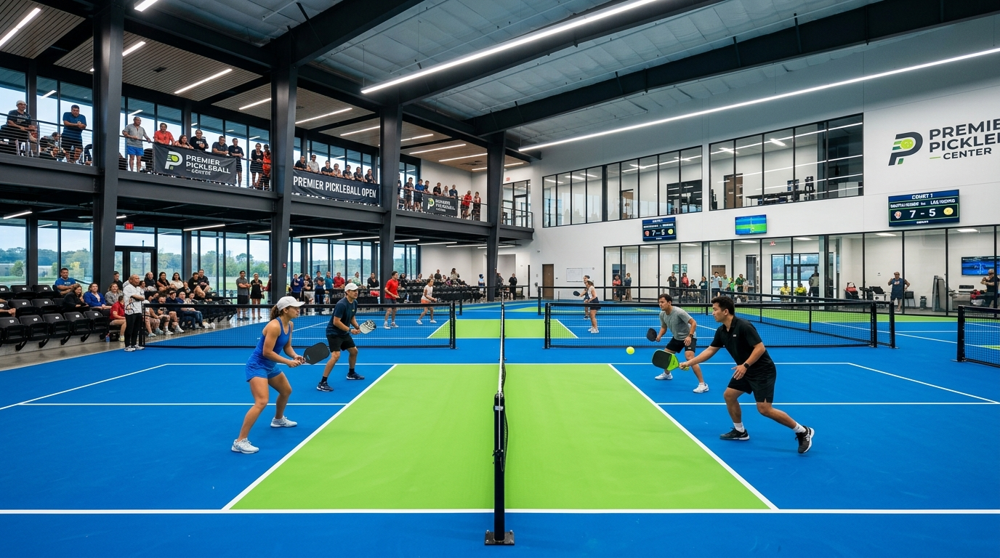
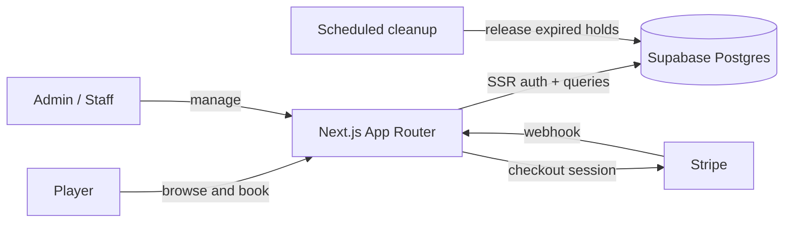

<div align="center">


**A real-time pickleball court booking platform for Butuan City, Philippines.**

Players see live court availability, reserve slots and pay online.
Venue staff run the whole operation from one admin dashboard.




</div>

---

## 🎯 The problem

Booking a court at a local venue usually means messaging a page, waiting for a reply and hoping nobody else grabbed the slot. **Crosshair Dinkers** replaces that with a self-service portal: open the grid, pick a court and time, pay, done, in under a minute.

## ✨ Highlights

| For players | For venue staff |
| --- | --- |
| 🟢 **Live availability grid** for every court | 📊 **Dashboard** with revenue and occupancy |
| 🛒 **Multi-court, multi-hour basket** in one checkout | 🗓️ **Daily schedule view** and court status control |
| 💳 **Stripe checkout** with automatic reconciliation | 📋 **Booking management**: confirm, complete or cancel |
| ⏳ **Slot holds with countdown** so nobody steals your slot mid-payment | 👥 **Customer directory** and payment history |
| 📱 **My Bookings** page for upcoming and past games | 🚶 **Walk-in bookings** for players at the counter |

## 🛡️ Built to be reliable

This isn't just a pretty UI. The booking engine is designed so the venue **never double-books a court**:

- **Database-level conflict prevention** through Postgres RPCs and row-level security in Supabase
- **Slot holds that expire** on their own, with a grace period and scheduled cleanup jobs
- **Payment reconciliation and a refund ledger** that keep Stripe and the database in sync
- **Booking lifecycle**: `pending → confirmed → completed` (or `cancelled`), with all cancellation rules based on venue local time (Asia/Manila)
- **Configurable pricing** that staff manage without touching code
- **Every migration has a matching rollback script** in `supabase/`

### 🧪 Tested

```
tests/
├── booking-rules · multi-hour-booking · venue-hours · countdown
├── quote-court-price · validate-pricing-input
├── reconcile-checkout-session · refund-worker · expired-booking-cleanup
├── admin-status-transitions · cron-auth
├── integration/   → real Postgres integration tests
└── e2e/           → Playwright browser tests
```

## 🧱 Architecture



## 🗺️ Routes

| Route | What it does |
| --- | --- |
| `/` | Landing page with venue info and the interactive booking grid |
| `/book` | Booking flow and checkout |
| `/my-bookings` | A player's upcoming and past reservations |
| `/admin/dashboard` | Revenue, occupancy and today's activity |
| `/admin/schedules` · `/admin/courts` | Daily schedules and court status |
| `/admin/bookings` · `/admin/payments` · `/admin/customers` | Operations management |

## 🚀 Run it locally

```bash
git clone https://github.com/Daniel2525-ui/Pickleball-Booking-System.git
cd Pickleball-Booking-System
npm install
```

Create a `.env.local` file:

```env
NEXT_PUBLIC_SUPABASE_URL=
NEXT_PUBLIC_SUPABASE_ANON_KEY=
SUPABASE_SERVICE_ROLE_KEY=
STRIPE_SECRET_KEY=
STRIPE_WEBHOOK_SECRET=
CRON_SECRET=
```

Apply the SQL files in `supabase/migrations`, then:

```bash
npm run dev          # start the app on http://localhost:3000
npm test             # unit tests
npm run test:e2e     # Playwright end-to-end tests
```

---

<div align="center">

Built by **[Erle Daniel Sudario](https://github.com/Daniel2525-ui)** · Butuan City 🇵🇭


</div>
