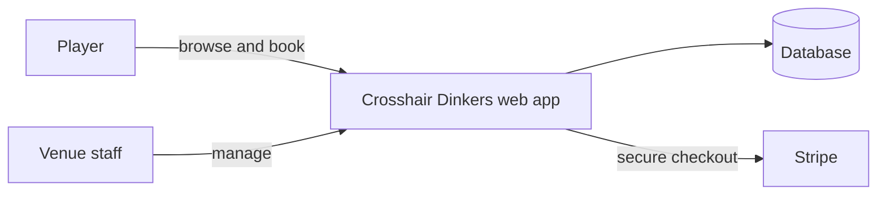

**A real-time pickleball court booking platform for Butuan City, Philippines.**

Players see live court availability, reserve slots and pay online.
Venue staff run the whole operation from one admin dashboard.

---

## 🎯 The problem

Booking a court at a local venue usually means messaging a page, waiting for a reply and hoping nobody else grabbed the slot. **Crosshair Dinkers** replaces that with a self-service portal: open the grid, pick a court and time, pay, done, in under a minute.

## ✨ Highlights

| For players | For venue staff |
| --- | --- |
| 🟢 **Live availability grid** for every court | 📊 **Dashboard** with revenue and occupancy |
| 🛒 **Multi-court, multi-hour basket** in one checkout | 🗓️ **Daily schedule view** and court status control |
| 💳 **Stripe checkout** with automatic reconciliation | 📋 **Booking management**: confirm, complete or cancel |
| ⏳ **Slot holds with countdown** so nobody steals your slot mid-payment | 👥 **Customer directory** and payment history |
| 📱 **My Bookings** page for upcoming and past games | 🚶 **Walk-in bookings** for players at the counter |

## 🛡️ Built to be reliable

This isn't just a pretty UI. The booking engine is designed so the venue **never double-books a court**:

- **Conflict prevention** that guarantees one booking per court per time slot
- **Temporary slot holds** so a player's slot is reserved while they pay
- **Payment and refund tracking** that keeps every booking in sync with its payment
- **Clear booking lifecycle**: `pending → confirmed → completed` (or `cancelled`), based on venue local time (Asia/Manila)
- **Configurable pricing** that staff manage without touching code
- **Automated tests**: unit, integration and end-to-end browser tests

## 🧱 How it works

## 🔒 Usage and license

This is **proprietary software** built for the Crosshair Dinkers venue. The source code is shared publicly **for portfolio and viewing purposes only**.

- ❌ No permission is granted to copy, modify, deploy, host or redistribute this project, in whole or in part
- ❌ Do not attempt to access, test or probe the live system, its admin areas or its data without written permission
- ✅ You're welcome to read the code and use it as a reference for learning

**© 2026 Erle Daniel Sudario. All rights reserved.**

Interested in a booking system for your own venue, or found a security issue? [Contact me through GitHub](https://github.com/Daniel2525-ui) instead.

---

Built by **[Erle Daniel Sudario](https://github.com/Daniel2525-ui)** · Cabadbaran City 🇵🇭

